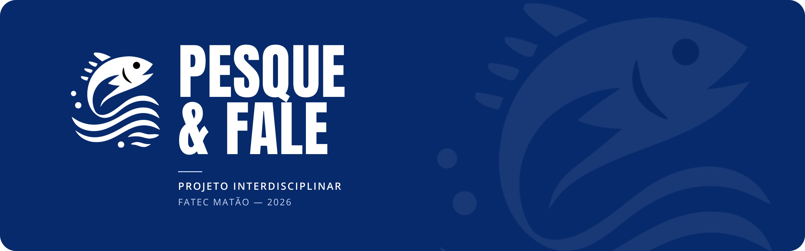
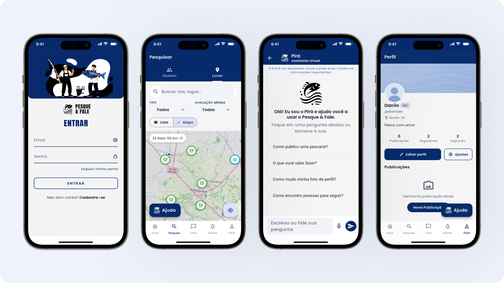
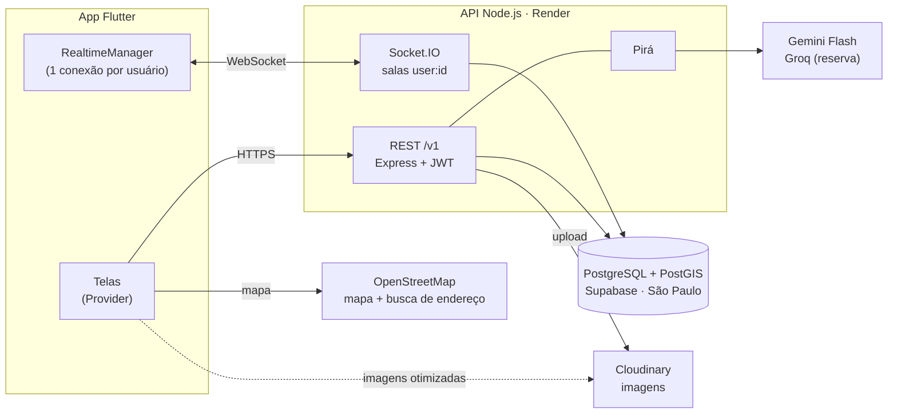
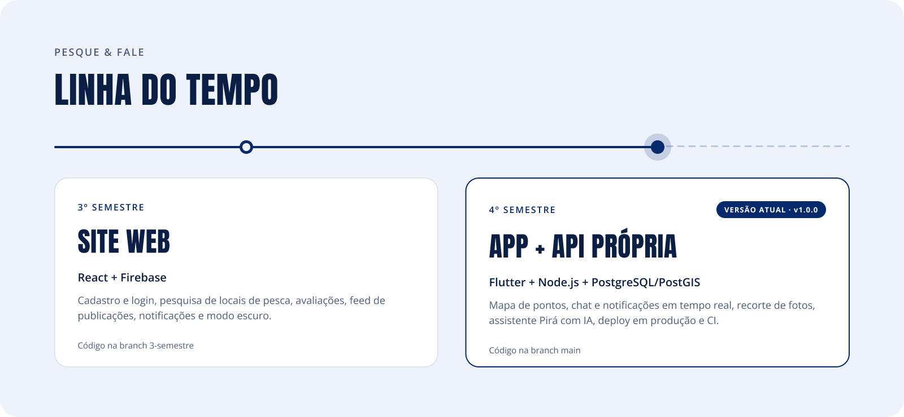
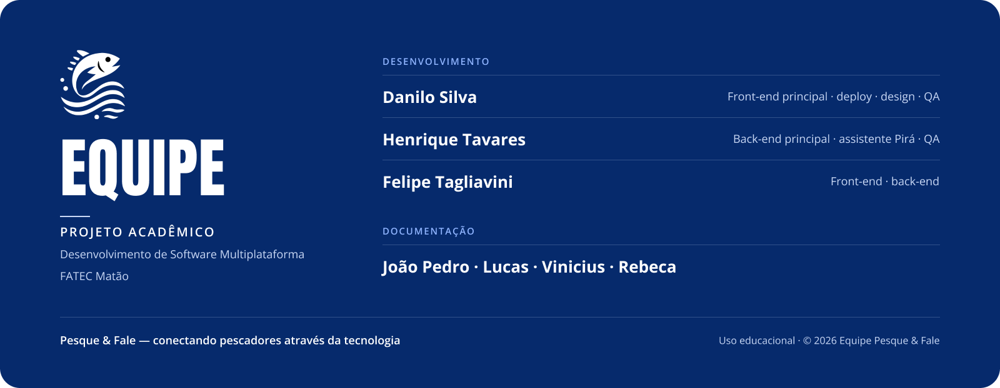

<div align="center">



<br>


[](https://github.com/daniykt/Pesque-Fale/releases/latest)
[](https://github.com/daniykt/Pesque-Fale/actions)
[](https://pesque-fale-api.onrender.com/docs)

<br>



</div>

---

## Pesque & Fale

Achar um lugar **bom, agradável e acessível** pra pescar ainda depende de indicação boca a boca. O **Pesque & Fale** junta isso num app: um mapa de pontos de pesca avaliados por quem já foi lá, e uma rede social pra pescadores trocarem experiência e fazerem amizade.

> **Tema ODS:** Vida na Água · Trabalho decente e crescimento econômico

Pensado pra um público que **não é nativo digital** (muitos pescadores têm 40+), o app prioriza botões grandes, fluxos curtos e páginas no lugar de janelas sobrepostas. Nada de dado falso na tela: só aparece o que o sistema realmente faz.

---

## Funcionalidades

| Funcionalidade | O que faz | RF |
|---|---|:-:|
| **Cadastro e login** | Conta própria com JWT; a sessão fica salva com segurança no aparelho | RF01 |
| **Onboarding + tour guiado** | Primeiro acesso guiado (foto, bio, username) e um tour que apresenta cada aba | — |
| **Mapa de pontos de pesca** | Pesqueiros, rios e represas no mapa, com busca por nome e por distância | RF02 |
| **Avaliações** | Nota de 1 a 5 e comentário por ponto; a média é calculada no banco | RF02 |
| **Feed e publicações** | Posts com foto, ponto de pesca, nota e tags; curtidas e comentários | RF06 |
| **Chat em tempo real** | Conversas 1:1 que chegam na hora, com status de enviado e visto | — |
| **Notificações em tempo real** | Curtidas, comentários, seguidores e mensagens aparecem na hora, com badge | RF04 |
| **Perfil** | Foto e banner com recorte, bio, seguidores e selos de equipe e conta oficial | RF05 |
| **Pirá, o assistente de IA** | Mascote que tira dúvidas sobre o app e sobre pesca | — |
| **Modo escuro + responsivo** | Tema claro e escuro, com layout que se adapta a celular e tablet | RNF01 |

<details>
<summary><b>Pontos oficiais cadastrados (região de Matão-SP)</b></summary>

<br>

A conta oficial do Pesque & Fale (selo **OFICIAL**) publica 9 pontos verificados pelo time:

| Tipo | Pontos |
|---|---|
| Pesqueiros | Recanto do Pescador · Rota do Peixe · Marucci · Terra Nostra |
| Represas | Ibitinga · Bariri |
| Rios | Pedra do Rio Mogi-Guaçu · Cachoeira de Emas · Porto de pesca Ponte do Rio Pardo |

> [!NOTE]
> Bariri e Cachoeira de Emas têm aviso de regulamentação de pesca na descrição.

</details>

---

## Arquitetura



**Decisões que valem destaque:**

- **API própria no lugar do Firebase.** Só a API conversa com o banco.
- **PostGIS pra busca por distância.** "Pontos a até X km de mim" é respondido direto no banco.
- **Imagens nunca em base64.** O app manda o arquivo pra API, a API envia pro Cloudinary e guarda só a URL.
- **Mapas sem chave e sem cartão.** OpenStreetMap + `flutter_map`: custo zero e sem depender de fornecedor.
- **Tempo real com uma única conexão.** Um `RealtimeManager` por usuário alimenta chat, notificações, seguidores e feed.

> [!TIP]
> Detalhes em [`docs/realtime-events.md`](docs/realtime-events.md), [`docs/epic-183-retrospectiva.md`](docs/epic-183-retrospectiva.md), [`docs/CI.md`](docs/CI.md) e [`docs/JWT_E_CLOUDINARY.md`](docs/JWT_E_CLOUDINARY.md).

---

## Stack

| Camada | Escolha | Por quê |
|---|---|---|
| App | **Flutter** + Provider + Material 3 | Um código só e UI consistente; Provider é simples de ensinar pro time |
| Design | Tokens `AppColors` · `AppSpacing` · `AppRadius` | Nada de cor ou espaçamento solto: o tema escuro sai de graça |
| API | **Node.js + Express** | Stack que o time domina, ecossistema grande |
| Auth | **JWT** + bcrypt + `flutter_secure_storage` | Padrão de mercado, sem depender do Google |
| Banco | **PostgreSQL + PostGIS** (Supabase) | Relacional de verdade + consultas geográficas nativas |
| Tempo real | **Socket.IO** | Chat, notificações e feed sem ficar perguntando ao servidor |
| Imagens | **Cloudinary** | Recorte e compressão pela própria URL |
| Mapas | **OpenStreetMap** + `flutter_map` + Nominatim | Gratuito, aberto, sem chave de API |
| IA | **Gemini Flash** (Groq de reserva) | Plano gratuito; a chave fica só na API |
| Deploy | **Render** (API) · **Supabase** (banco) | Planos gratuitos que dão conta do projeto |
| CI/CD | **GitHub Actions** | Análise e testes em todo PR; APK gerado a cada release |

### Em números

<div align="center">

| Testes do app | Testes da API | Tabelas | Pontos oficiais | Commits |
|:-:|:-:|:-:|:-:|:-:|
| **750+** | **230+** | **11** | **9** | **860+** |

</div>

---

## Para devs

> [!IMPORTANT]
> **Só quer testar?** Baixe o APK na [última release](https://github.com/daniykt/Pesque-Fale/releases/latest): ele já aponta pra API em produção.
>
> A API está no plano gratuito do Render: **a primeira requisição pode levar de 30 a 50 segundos** enquanto o servidor acorda.
>
> Já tem uma versão anterior instalada? **Desinstale antes de instalar a nova**:
> cada build é assinado com uma chave diferente e o Android bloqueia a atualização.

<details>
<summary><b>Como rodar o app (Flutter)</b></summary>

<br>

> **Pré-requisitos:** Flutter SDK 3.44.4 · Android Studio ou um aparelho com depuração USB

```bash
git clone https://github.com/daniykt/Pesque-Fale.git
cd Pesque-Fale/pesque_fale_app
flutter pub get
flutter run
```

Por padrão, o app usa a API de produção. Pra apontar pra uma API local:

```bash
# 10.0.2.2 é o localhost do computador visto de dentro do emulador Android
flutter run --dart-define=API_BASE_URL=http://10.0.2.2:3333/v1
```

</details>

<details>
<summary><b>Como rodar a API (Node.js)</b></summary>

<br>

> **Pré-requisitos:** Node.js 18+ · PostgreSQL com PostGIS · conta gratuita no [Cloudinary](https://cloudinary.com)

```bash
cd Pesque-Fale/api
cp .env.example .env      # preencha as variáveis da tabela abaixo
npm install
npm run migrate           # aplica as migrations em ordem; pode rodar mais de uma vez
npm run dev               # sobe em http://localhost:3333
```

Swagger em **http://localhost:3333/docs** · verificação de saúde em **/health**

| Variável | Pra quê | Obrigatória? |
|---|---|:-:|
| `PORT` | Porta da API (padrão `3333`) | opcional |
| `DATABASE_URL` | Conexão com o Postgres | ✅ |
| `JWT_SECRET` | Assinatura dos tokens (em produção, uma string longa e aleatória) | ✅ |
| `JWT_EXPIRES_IN` | Validade do token de acesso | ✅ |
| `CLOUDINARY_CLOUD_NAME` · `CLOUDINARY_API_KEY` · `CLOUDINARY_API_SECRET` | Upload de fotos e banners | ⚠️ sem elas, o upload falha |
| `GEMINI_API_KEY` · `GEMINI_MODEL` | Pirá (assistente de IA) | ⚠️ sem elas, o Pirá fica desligado |
| `GROQ_API_KEY` · `GROQ_MODEL` | Reserva do Pirá | opcional |

> [!WARNING]
> O `.env` **nunca** vai pro Git. Se uma chave vazar, gere outra no painel do serviço e desative a antiga.

</details>

<details>
<summary><b>Testes e qualidade</b></summary>

<br>

```bash
# App
cd pesque_fale_app
flutter analyze
flutter test

# API
cd api
npm test
```

São os mesmos comandos que o CI roda: se passa aí, passa no PR.

</details>

<details>
<summary><b>Estrutura de pastas</b></summary>

<br>

```text
Pesque-Fale/
├── .github/workflows/        # CI e build do APK
├── api/                      # Backend Node.js / Express
│   ├── src/                  #   módulos (rotas, controllers, socket), middlewares, config
│   ├── db/migrations/        #   schema + seed dos pontos oficiais
│   ├── scripts/migrate.js    #   aplica as migrations (npm run migrate)
│   ├── tests/                #   Jest
│   └── .env.example
├── pesque_fale_app/          # App Flutter
│   └── lib/
│       ├── core/             #   tema, tokens, config, tempo real
│       ├── features/         #   uma pasta por funcionalidade → data / domain / presentation / providers
│       ├── shared/
│       │   ├── utils/        #   funções utilitárias
│       │   └── widgets/      #   componentes reutilizáveis
│       └── main.dart
├── docs/                     # documentação técnica + imagens do README
└── README.md
```

</details>

<details>
<summary><b>Fluxo de branches e commits</b></summary>

<br>

- **Scrum no GitHub Projects:** cada fase vira uma sprint e cada task vira uma issue (ex.: `9.6`).
- **Branches:** tudo nasce da `dev` → PR com CI verde → **squash merge** na `dev` → as versões com tag sobem pra `main`.
- **Commits:** [Conventional Commits](https://www.conventionalcommits.org/pt-br/) em português (`feat:`, `fix:`, `docs:`, `refactor:`…).
- **Releases:** cada tag gera um APK anexado na [página de releases](https://github.com/daniykt/Pesque-Fale/releases).

</details>

---

<picture>
  <source media="(prefers-color-scheme: dark)" srcset="docs/assets/timeline.png">
  
</picture>

---


